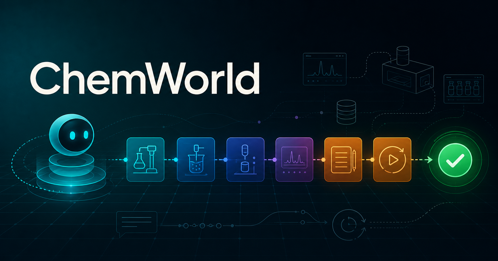

# ChemWorld



**Programmable chemical worlds for controlled, replayable agent experimentation.**

[Documentation](https://sunyrain.github.io/ChemWorld-Public/) ·
[First experiment](https://colab.research.google.com/github/sunyrain/ChemWorld-Public/blob/v0.3.0/notebooks/01_first_experiment.ipynb) ·
[Student Lab](#student-lab-no-model-required) ·
[Connect an agent](docs/agents.md) ·
[Evidence](docs/evidence.md) ·
[Current foundation](docs/current-foundation.md)

ChemWorld gives experimental agents a typed laboratory interface rather than an answer-only benchmark. An agent inspects a public task contract, commits physically constrained operations, uses instruments, spends explicit resources, encounters recoverable failures and leaves a transaction-complete trace that can replay exactly.

[Explore every action and observation in the interactive documentation →](https://sunyrain.github.io/ChemWorld-Public/one-experiment/)

Current main is the October 2026 foundation snapshot (`0.5.0.dev0`): multi-vessel
material routing, repeated crystallization, process controls, finite streams,
configurable NMR/IR/MS and coupled-equilibrium worlds are now public.
See [what changed and model scope](docs/current-foundation.md) and the
[open-source extension roadmap](docs/extension-roadmap.md).

## Start in five minutes

ChemWorld supports Python 3.11 and 3.12.

```bash
git clone https://github.com/sunyrain/ChemWorld-Public.git
cd ChemWorld-Public
uv sync --locked --extra dev
uv run --no-sync python examples/demo_manual_event_sequence.py
```

The tutorials require no provider key:

| Notebook | What you do | Run |
| --- | --- | --- |
| `01_first_experiment` | Inspect a Reaction-to-Assay contract, validate actions, use HPLC and complete a final assay | [Open in Colab](https://colab.research.google.com/github/sunyrain/ChemWorld-Public/blob/v0.3.0/notebooks/01_first_experiment.ipynb) |
| `02_reaction_to_purification` | Continue through extraction, wash, drying and concentration | [Open in Colab](https://colab.research.google.com/github/sunyrain/ChemWorld-Public/blob/v0.3.0/notebooks/02_reaction_to_purification.ipynb) |
| `03_controlled_world_change` | Hold the public experiment fixed while one registered world component changes | [Open in Colab](https://colab.research.google.com/github/sunyrain/ChemWorld-Public/blob/v0.3.0/notebooks/03_controlled_world_change.ipynb) |

Checked-in notebook outputs are deterministic public demonstrations, not benchmark results or optimized laboratory procedures.

## Student Lab (no model required)

Launch the animated browser workbench after installing the package:

```bash
chemworld lab
```

The Lab runs locally on `127.0.0.1`, uses the same typed action schemas and transactional Gym
runtime as normal experiments, and requires no model, provider account or API key. It visualizes
only public action effects and observations; the animation does not infer hidden composition.

## Bring your own agent

The public runner accepts any Python object implementing the small ChemWorld agent protocol. Start
with an offline agent, then opt into the audited DeepSeek or Codex subscription adapters only when
you need a live model. Provider credentials stay in environment variables and live runs record
resource and model provenance separately from environment score.

[Follow the custom and live-agent guide →](docs/agents.md)

## What ChemWorld exposes

- **Composable worlds:** reaction, thermal, phase, separation, crystallization, distillation, flow, electrochemical and observation components behind one compatibility-checked contract.
- **Agent-facing operations:** public task prompts, parameter schemas, action validation, instruments, observations, failure reasons, resources and termination.
- **Transactional execution:** accepted actions commit atomically; failed runtime preconditions roll back physical state while retaining registered attempt consequences.
- **Controlled world forks:** experiment authors can change one registered private component while holding the public contract and typed action sequence fixed.
- **Exact replay:** submitted traces—including rolled-back requests—remain reconstructable and auditable.

## Frozen evidence

The following results and illustration belong to the frozen August runtime. They remain
unchanged historical evidence, not a qualification of current main. Reproduce them with the
[pinned snapshot](https://github.com/sunyrain/ChemWorld-Public/tree/db98e8002fac0512ed9084a3c8c27985cb9fc405);
the notebook links above also stay pinned:


- 64/64 registered task–world units and 1,786/1,786 reference recipes completed.
- 52/52 coverage-generated compositions completed, including 8/8 non-reference reaction–distillation worlds.
- Eight deterministic lifecycles checked all 89 submitted actions: 88 committed and one planned rollback.
- Six controlled parent–child world pairs produced 24 provider-free traces.
- One independent agent completed a 15-action public-instrument lifecycle.

These are finite software-model qualification results. They do not establish universal chemical fidelity, general agent intelligence or transfer to a physical laboratory.

## Verify offline

```bash
uv sync --locked --extra dev
uv run --no-sync pytest -q
uv run --no-sync python scripts/build_readme_visuals.py --check
```

Current checks exercise the runtime and preserve the frozen evidence. The original whole-tree
release verifier belongs to the pinned August checkout; see [contributing](CONTRIBUTING.md).

## Release boundary

This repository contains the current development runtime, public protocols, historical sanitized evidence, pinned tutorial outputs, documentation, examples and focused tests. It excludes manuscript files and assets, development matrices, draft/interim/pilot results, raw provider responses, provider session identifiers, private evaluator configuration, credentials and study-specific development artifacts.

See [CITATION.cff](CITATION.cff) for citation metadata. The software is available under the [MIT License](LICENSE).
