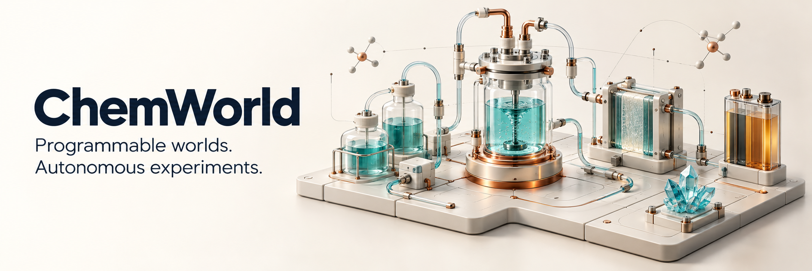
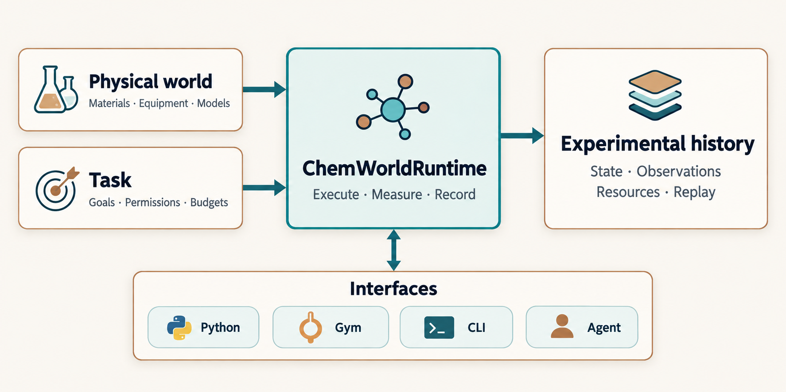
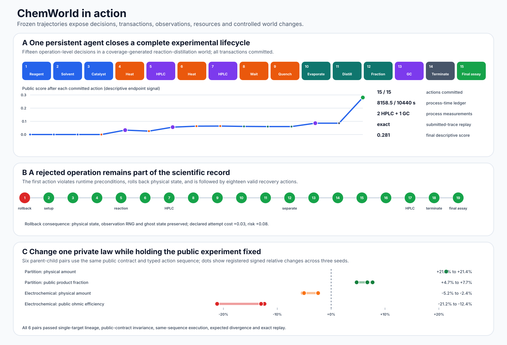

<p align="center"><strong>English</strong> · <a href="README.zh-CN.md">简体中文</a></p>

<p align="center">
  
</p>

<p align="center">
  <strong>A native simulation foundation for agents that experiment.</strong>
</p>

<p align="center">
  <a href="https://www.python.org/downloads/"></a>
  <a href="LICENSE"></a>
  <a href="pyproject.toml"></a>
  <a href="docs/native_domains.md"></a>
</p>

<p align="center">
  <a href="#quick-start">Quick start</a> ·
  <a href="#experimental-domains">Capabilities</a> ·
  <a href="#milestones">Milestones</a> ·
  <a href="docs/native_domains.md">Examples</a> ·
  <a href="docs/native_foundation.md">Native API</a> ·
  <a href="docs/agents.md">Connect an agent</a> ·
  <a href="https://sunyrain.github.io/ChemWorld-Public/explore/?lang=en">Interactive website</a> ·
  <a href="README.zh-CN.md">中文 README</a>
</p>

## Build a world. Let an agent explore it.

ChemWorld gives autonomous agents a chemical world they can act on: add material,
heat a reactor, separate a mixture, take a measurement and choose the next experiment.
Results come from physical models and evolving state. Samples change, stocks run down,
equipment retains its history, and earlier choices shape what can happen next.

You define the chemistry, apparatus and task. ChemWorld handles physical evolution,
native measurements, resource accounting and replay through one runtime shared by
**Python, Gym, CLI and Agent interfaces**.

Use it to develop experimental policies, study how agents use observations, or build
reproducible simulation exercises. Change the world, available information or research
budget while keeping the experimental process inspectable.

## Milestones

Major updates, grouped by public availability. See [current foundation](docs/current-foundation.md)
for implementation scope and validation, or explore the [interactive timeline](https://sunyrain.github.io/ChemWorld-Public/explore/?lang=en#home).

| Date | Capability update |
| --- | --- |
| **2026-10-22** | **Property data, gas thermodynamics and circuit workflows.** External density/volume sources; second- and third-virial coefficients, cross parameters and mixture rules; pure-gas properties and closed, fixed-volume thermal processes. Thevenin circuits connect to persistent equipment, shared time and in-situ measurements. |
| **2026-10-21** | **Scientific models and interoperability.** Shared residual/DAE infrastructure; bounded SPMe/DFN and particle-distribution battery models, impedance and state-of-health diagnostics; expanded property methods, selected CALPHAD/ChemSage models and supported SBML/SED-ML subsets. |
| **2026-10-19–20** | **A composable native foundation.** Gas, bulk and surface reactions alongside separation, membranes, crystallization, mineral and solid phases, and stochastic networks. Shared time, retained devices and measurement queues connect workflows across Python, Gym, CLI and Agent interfaces, with continuation and exact replay. |
| **2026-08-12** | **Experimental agents, ready to run.** Provider-free Student Lab, offline examples and tutorial notebooks bring together experimental actions, measurements, resource accounting and replay. |

## Quick start

Install [uv](https://docs.astral.sh/uv/getting-started/installation/).
Use Python 3.11 or 3.12. The native examples require neither model credentials nor
optional upstream chemistry solvers.

```bash
git clone https://github.com/sunyrain/ChemWorld-Public.git
cd ChemWorld-Public
uv sync --locked --extra dev

# Run a complete surface + bulk reaction experiment.
uv run --no-sync python -m chemworld.examples.native_surface_research --bulk --mobile --terminal-assay
```

The example performs **12 operations**: feed finite stocks, heat, measure, wait,
transfer material, continue in the receiving vessel and finish with an assay.
Its JSON output contains each action's outcome, actual physical duration and
instrument readings with native units.

Prefer an interactive introduction? Start the local [Student Lab](#student-lab)
with `uv run --no-sync chemworld lab`.

## What makes the foundation useful

<table>
<tr>
<td width="50%" valign="top">
<strong>Compose worlds independently of tasks</strong><br>
Declare materials, vessels, equipment and physical models. Bind goals, permissions,
budgets and ending conditions separately, so the same apparatus can support different
research questions.
</td>
<td width="50%" valign="top">
<strong>Reuse equipment across domains</strong><br>
A heater connects to a compatible vessel through the same thermal interface.
Calibration stays with the device; material moves through declared ports.
The integrated heater example carries one device across three domains.
</td>
</tr>
<tr>
<td valign="top">
<strong>Keep the consequences of an experiment</strong><br>
Catalyst coverage, membrane fouling, battery degradation and instrument history
belong to persistent entities. Later operations use the state left by earlier ones.
</td>
<td valign="top">
<strong>Advance compatible physics together</strong><br>
Coupled processes share inventories, a solver and energy accounting.
Optional shared laboratory time also advances independent vessels and schedules
equipment queues and delayed results.
</td>
</tr>
<tr>
<td valign="top">
<strong>Observe through explicit instruments</strong><br>
Readings retain units, shape, quality and sampling time. Authored instrument contracts
define noise, limits and sample consumption; hidden world state stays separate from
the agent's observations.
</td>
<td valign="top">
<strong>Inspect and replay what happened</strong><br>
Transactions check declared exchanges and conservation before committing.
Histories retain outcomes and resource use; snapshots support continuation and
recorded trajectories can be verified by replay.
</td>
</tr>
</table>

## Experimental domains

The development foundation includes the following native models. Each connects to the
same state, operation, measurement and transaction contracts.

| Domain | Available native models | Start here |
| --- | --- | --- |
| Reactions and catalysis | Bulk kinetics, gas mechanisms, finite surface sites, reversible two-site interactions and coupled heat | [Surface example](src/chemworld/examples/native_surface_research.py), [mechanism import](docs/native_mechanisms.md) |
| Thermodynamics and phase processes | State-dependent properties, TP/PH flash, liquid–liquid equilibrium, finite distillation, concentration, adsorption and crystallization | [Physical models guide](docs/native_foundation.md#properties-at-the-current-state) |
| Transport and separation | Finite tanks, pressure/power-limited pumps, heat exchange, reverse osmosis, persistent fouling and rinsing | [Transport example](src/chemworld/examples/native_liquid_transport.py), [membrane example](src/chemworld/examples/native_membrane_fouling.py) |
| Electrochemistry and batteries | Conservative diffusion, finite electrodes, SPM/SPMe/DFN and particle-distribution models, CC/CV/rest cycling, thermal response and SEI | [Battery examples](docs/native_domains.md) |
| Water and minerals | Dilute carbonate equilibrium, finite calcite dissolution/precipitation and phase-owned surface geometry | [Mineral example](src/chemworld/examples/native_mineral_research.py) |
| Stochastic biochemistry | Gillespie events, reversible/enzyme networks, integer inventories and separate process/measurement randomness | [Biochemical worlds](docs/native_biochemical.md) |
| Solid phases | Finite substitutional equilibrium, selected TDB/CEF and ChemSage inputs, supported multi-sublattice and quasichemical models | [Native foundation guide](docs/native_foundation.md) |
| Instruments and scheduling | Programmed chromatography, persistent instrument history, shared heater/analyzer queues and timed readouts | [Shared laboratory guide](docs/native_shared_lab.md) |

These are bounded models with explicit equations, parameters and operating ranges.
For example, each battery family has its own declared discretization and material
contract; membrane and solid-phase models retain their documented finite scope.
See [model ranges](docs/extension-roadmap.md) and the
[module declarations](docs/native_capabilities.md) before composing a new system.

## Try a connected experiment

The [integrated examples](docs/native_domains.md) show how capabilities work together
over a sequence of operations.

| Example | Follow the experiment |
| --- | --- |
| Shared heater | Move one calibrated heater from a surface reactor to an adsorption vessel and a thermal battery |
| Membrane | Complete three process/rinse cycles with finite feed and wash water, retaining the membrane's fouling history |
| Minerals | Add acid, evolve carbonate/calcite chemistry, transfer a phase and sample for pH |
| Shared clock | Advance separate stochastic and deterministic vessels while competing requests share one offline analyzer |
| Distillation | Switch through full reflux and collect a fraction from a column with finite inventories |
| Crystallization | Cool, filter, resuspend, warm and cool again while retaining material and samples |
| Solid solution | Observe binary demixing through heating and cooling |

Run the heater history and verify its recorded trajectory:

```bash
uv run --no-sync python -m chemworld.examples.native_domains --workflow heater --output runs/native-domains
uv run --no-sync chemworld verify --submission runs/native-domains/heater.jsonl
```

Select another workflow with `--workflow membrane`, `mineral`, `shared-clock`,
`distillation`, `crystal` or `solid`. These are fixed, provider-free demonstrations;
connect your own policy to make the experimental choices. Use `--noise-mode keyed`
for keyed detector noise; sequential noise is the default.

## One runtime, four ways to use it



The world describes what can physically happen; the task describes what the researcher
may do and what it is trying to achieve. Python, Gym, CLI and Agent send actions and
receive observations through the same experimental session. That session records
physical state, measurements and resource use for inspection and replay.

### Python

```python
from chemworld.runtime import ChemWorldRuntime
from chemworld.world.surface_world import surface_world_spec

session = ChemWorldRuntime(composition=surface_world_spec())
session.reset(seed=12)
session.execute({
    "operation": "add_component", "component": "CO-feed", "amount_mol": 2e-5,
})
reading = session.execute({"operation": "measure", "instrument": "gas_pressure"})
for channel in reading.observation.channels:
    print(channel.channel_id, channel.value, channel.unit, channel.quality)
session.close()
```

### Gym, CLI and agents

| Entry point | Use it for | Interface |
| --- | --- | --- |
| Gym | Policy and reinforcement-learning integration | `ChemWorldEnv(composition=spec)` |
| CLI | Execute JSON action sequences and inspect trajectories | `chemworld render`, `chemworld verify` |
| Agent runner | Your planner or policy selecting typed operations | `run_agent(..., composition=spec.to_dict())` |

The [session guide](docs/native_foundation.md#use-the-same-session-through-other-entry-points)
covers native observations, the Gym compatibility projection and snapshot continuation.
The [agent guide](docs/agents.md) covers custom Python policies, offline baselines,
captured-trace replay and optional live-model adapters. Examples run offline; external
models are an explicit choice.

### Student Lab

Explore the tutorial tasks in an animated browser workbench:

```bash
uv run --no-sync chemworld lab
```

Student Lab runs locally on `127.0.0.1` and uses the same session and action schemas.
Choose operations and inspect their visible effects without an API key. Its tutorial
catalog is a starting point; the Python examples expose the broader native domains.

## Documentation

**[Explore the website in English](https://sunyrain.github.io/ChemWorld-Public/explore/?lang=en)** ·
**[浏览中文版网站](https://sunyrain.github.io/ChemWorld-Public/explore/?lang=zh)**

The capability atlas, index and domain guides share one navigation. Recorded examples
play saved public test observations; they do not start a live laboratory or run new physics.

| I want to… | Read |
| --- | --- |
| Build and run a native world | [Native foundation guide](docs/native_foundation.md) |
| Run complete examples | [Integrated workflows](docs/native_domains.md) |
| Connect a planner, model or policy | [Agent integration](docs/agents.md) |
| Check a model's assumptions and limits | [Model ranges and extensions](docs/extension-roadmap.md) |
| Inspect registered operations and ownership | [Native capability declarations](docs/native_capabilities.md) |
| Use queues and delayed measurements | [Shared laboratory time](docs/native_shared_lab.md) |
| Read this introduction in Chinese | [完整中文 README](README.zh-CN.md) |

## Develop and extend

Extensions should become native capabilities that other domains can reuse:

1. **Specify the model.** Define equations, units, parameter ranges and a finite reference case.
2. **Declare ownership and interfaces.** State what belongs to material, a vessel or a device,
   and how it moves, persists and exchanges matter or energy.
3. **Use the shared runtime.** Contribute processes, operations or instrument contracts
   through module declarations.
4. **Validate actual behavior.** Check physical limits and balances, then execute,
   serialize and replay a complete experiment through the supported interfaces.

Upstream scientific tools inform equations and bounded reference comparisons.
Production execution uses ChemWorld's native implementations; optional reference
dependencies stay separate. Reused code and data retain their licensing and provenance.

Run the focused foundation checks:

```bash
uv run --no-sync pytest tests/test_domain_modules.py tests/test_native_foundation_end_to_end.py tests/test_lab_clock.py -q
```

See [CONTRIBUTING.md](CONTRIBUTING.md) for development and packaging checks.
[Open an issue](https://github.com/sunyrain/ChemWorld-Public/issues) for a reproducible
bug, a proposed model or an interface improvement. For a new domain, include the intended
experiment, governing equations and expected operating range.

**Development status.** Current source is `0.5.0.dev0`. Integration checks exercise
ten workflows through four entry points, both detector-noise modes and continuation
in a fresh process. Independent wheel/sdist checks run the examples and replay their
trajectories outside the checkout. Supported combinations and model limits are
documented in the guides above. The historical results below belong to their pinned runtime.

<details>
<summary>Earlier tutorials and frozen evidence</summary>

The tutorials require no provider key and remain pinned to `v0.3.0`:

| Notebook | What you do | Run |
| --- | --- | --- |
| `01_first_experiment` | Inspect a Reaction-to-Assay contract, validate actions, use HPLC and complete a final assay | [Open in Colab](https://colab.research.google.com/github/sunyrain/ChemWorld-Public/blob/v0.3.0/notebooks/01_first_experiment.ipynb) |
| `02_reaction_to_purification` | Continue through extraction, wash, drying and concentration | [Open in Colab](https://colab.research.google.com/github/sunyrain/ChemWorld-Public/blob/v0.3.0/notebooks/02_reaction_to_purification.ipynb) |
| `03_controlled_world_change` | Hold the public experiment fixed while one registered world component changes | [Open in Colab](https://colab.research.google.com/github/sunyrain/ChemWorld-Public/blob/v0.3.0/notebooks/03_controlled_world_change.ipynb) |

Checked-in notebook outputs are deterministic public demonstrations, not benchmark results or optimized laboratory procedures.

### Frozen evidence

The following results and illustration belong to the frozen August runtime. They remain
unchanged historical evidence, not a qualification of current main. Reproduce them with the
[pinned snapshot](https://github.com/sunyrain/ChemWorld-Public/tree/db98e8002fac0512ed9084a3c8c27985cb9fc405);
the notebook links above also stay pinned:



- 64/64 registered task–world units and 1,786/1,786 reference recipes completed.
- 52/52 coverage-generated compositions completed, including 8/8 non-reference reaction–distillation worlds.
- Eight deterministic lifecycles checked all 89 submitted actions: 88 committed and one planned rollback.
- Six controlled parent–child world pairs produced 24 provider-free traces.
- One independent agent completed a 15-action public-instrument lifecycle.

These are finite software-model qualification results. They do not establish universal chemical fidelity, general agent intelligence or transfer to a physical laboratory.

The original whole-tree release verifier belongs to the pinned August checkout;
see [evidence documentation](docs/evidence.md). Frozen illustration consistency
can be checked with `uv run --no-sync python scripts/build_readme_visuals.py --check`.

</details>

## Scope, citation and license

This public repository contains the simulation foundation, interfaces, examples,
documentation, focused tests and retained historical public evidence. Manuscripts,
private study configurations, credentials and raw provider responses remain outside
this repository.

If you use ChemWorld, see [CITATION.cff](CITATION.cff) for citation metadata.
ChemWorld is available under the [MIT License](LICENSE).
